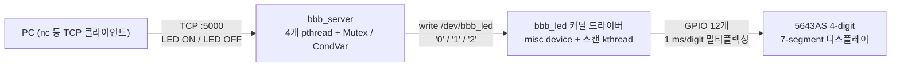

# BBB Embedded Linux — 원격 7-Segment 제어 시스템

BeagleBone Black(BBB) 기반 Embedded Linux BSP부터 커널 디바이스 드라이버, 멀티스레드 TCP 애플리케이션까지 직접 구현한 원격 하드웨어 제어 시스템입니다.

PC에서 TCP로 `LED ON` / `LED OFF` 명령을 보내면 BBB에 연결된 5643AS 4-digit 7-segment 디스플레이에 ` On ` / 소등 / `Err ` 를 표시합니다.

> **구현 완료** — BSP 구성부터 Device Tree, 커널 드라이버, 멀티스레드 애플리케이션, 시스템 통합·최종 검증까지 전 계층의 구현을 완료한 BSP 개발 포트폴리오 프로젝트입니다.

## 시스템 구성



| 계층 | 구현 | 위치 |
|---|---|---|
| BSP | Buildroot 2025.02.19, Linux 6.6.58, U-Boot / Kernel / RootFS 빌드·부팅 | 작업 환경 (`buildroot-2025.02.19/`) |
| Device Tree | 7-segment용 GPIO 12개 pinmux + `bbb,ext-led` 노드 | `buildroot/dts/am335x-boneblack.dts` |
| Kernel Driver | Platform + misc device 드라이버, GPIO descriptor API, 스캔 kthread | `buildroot/driver/bbb_led.c`, `bbb_led.h` |
| User Application | TCP 서버, 4개 pthread 파이프라인, Mutex/Condition Variable 동기화 | `application/bbb_server.c` |

## 하드웨어

- **보드:** BeagleBone Black (TI AM335x)
- **표시 장치:** 5643AS 4-digit 7-segment, common-cathode, 드라이버 IC 없는 bare 모듈
  - 세그먼트 8개(a–g, dp) + 디지트 공통단 4개 = **GPIO 12개** 필요
  - 한 번에 1개 디지트만 켤 수 있어 커널 스레드가 D1→D2→D3→D4를 1 ms 간격으로 스캔(디지트당 250 Hz), 잔상 효과로 4자리가 동시에 보이는 것처럼 표시
  - 세그먼트 라인마다 220–330 Ω 저항 필요
  - 디지트 공통단은 최대 8개 세그먼트 전류의 합을 sink하므로 BBB GPIO로 직접 구동하지 않고 **NPN 트랜지스터(또는 ULN2803)** 를 통해 구동 (GPIO high = 디지트 선택, `GPIO_ACTIVE_HIGH`)

### 배선 (Device Tree 기준)

| 신호 | 핀 | GPIO | 신호 | 핀 | GPIO |
|---|---|---|---|---|---|
| a | P9_12 | gpio1_28 | e | P9_23 | gpio1_17 |
| b | P9_14 | gpio1_18 | f | P8_12 | gpio1_12 |
| c | P9_16 | gpio1_19 | g | P8_11 | gpio1_13 |
| d | P9_15 | gpio1_16 | dp | P8_15 | gpio1_15 |

| 디지트 | 핀 | GPIO | 비고 |
|---|---|---|---|
| D1 | P8_16 | gpio1_14 | NPN 트랜지스터 경유 |
| D2 | P8_26 | gpio1_29 | NPN 트랜지스터 경유 |
| D3 | P8_7 | gpio2_2 | NPN 트랜지스터 경유 |
| D4 | P8_8 | gpio2_3 | NPN 트랜지스터 경유 |

## 커널 드라이버 — `bbb_led`

초기 단일 LED 드라이버의 사용자 인터페이스를 그대로 유지하면서 내부를 7-segment 멀티플렉싱 드라이버로 교체했습니다. 애플리케이션은 여전히 `LED ON` / `LED OFF` 개념만 알면 됩니다.

- **probe:** Device Tree에서 `seg-gpios`(8개), `digit-gpios`(4개)를 gpiod descriptor API(`devm_gpiod_get_array`)로 획득, 개수 검증
- **스캔 kthread:** ghosting 방지를 위해 전 디지트 blank → 세그먼트 패턴 적용 → 현재 디지트만 선택, `usleep_range(1000, 1200)` 주기
- **동기화:** 표시 상태(`value`)는 mutex로 보호, 파일 연산에서는 상태만 기록하고 실제 GPIO 제어는 스캔 스레드가 수행

### 디바이스 인터페이스 — `/dev/bbb_led`

| 연산 | 사용법 | 설명 |
|---|---|---|
| write | `write(fd, "1", 1)` | `'0'`=소등, `'1'`=` On ` 표시, `'2'`/`'E'`=`Err ` 표시, 그 외 `-EINVAL` |
| read | `read(fd, buf, n)` | 현재 상태를 `"0\n"` ~ `"2\n"` 로 반환 |
| ioctl | `BBB_LED_IOC_SET` | 상태 설정 (`int` 인자, 범위 검사 수행) |
| ioctl | `BBB_LED_IOC_GET` | 현재 상태 조회 |
| ioctl | `BBB_LED_IOC_TOGGLE` | ON ↔ 소등 토글 (ERR 상태에서는 ON으로) |

### 표시 상태

| 상태 | 값 | 표시 | 의미 |
|---|---|---|---|
| `BBB_LED_STATE_BLANK` | 0 | (소등) | LED OFF |
| `BBB_LED_STATE_ON` | 1 | ` On ` | LED ON |
| `BBB_LED_STATE_ERR` | 2 | `Err ` | 잘못된 명령 |

## 애플리케이션 — `bbb_server`

TCP 포트 **5000**에서 단일 클라이언트 접속을 받아, 4개 스레드가 Condition Variable로 연결된 파이프라인 형태로 동작합니다. 공유 변수는 하나의 mutex로 보호하고, 각 단계는 `*_ready` 플래그 + `pthread_cond_broadcast()`로 다음 스레드를 깨웁니다.

| 스레드 | 역할 |
|---|---|
| `receive_thread` | `recv()`로 명령 수신, 줄바꿈 제거 후 공유 버퍼 `command`에 저장 |
| `command_thread` | 문자열 해석: `LED ON`→1, `LED OFF`→0, 그 외→-1 |
| `control_thread` | `/dev/bbb_led`에 상태 기록(`apply_gpio`), 응답 문자열 생성. 잘못된 명령이면 ERR 상태 표시 |
| `status_thread` | 결과를 클라이언트로 `send()` (`MSG_NOSIGNAL`로 SIGPIPE 방지) |

클라이언트 연결이 끊기면 `stop_threads()`가 `running=false` + broadcast로 전 스레드를 깨워 정상 종료합니다.

### 프로토콜

| 요청 (PC → BBB) | 응답 (BBB → PC) | 디스플레이 |
|---|---|---|
| `LED ON` | `LED ON` | ` On ` |
| `LED OFF` | `LED OFF` | 소등 |
| 그 외 문자열 | `ERROR: invalid command` | `Err ` |

## 빌드 및 실행

### 1. 커널 드라이버 반영

```bash
# Buildroot가 빌드하는 커널 소스(drivers/misc/)에 드라이버 복사
cp buildroot/driver/bbb_led.c buildroot/driver/bbb_led.h \
   <linux-src>/drivers/misc/

# Kconfig / Makefile에 BBB_LED 항목 추가
# (repo의 buildroot/driver/Kconfig, Makefile은 BBB_LED가 이미 추가된 전체 파일)
#   Kconfig : config BBB_LED (tristate, depends on OF && GPIOLIB)
#   Makefile: obj-$(CONFIG_BBB_LED) += bbb_led.o

# Device Tree 교체
cp buildroot/dts/am335x-boneblack.dts <linux-src>/arch/arm/boot/dts/ti/omap/

# 커널 설정에서 드라이버 활성화 (repo의 buildroot/.config는 사용 중인 커널 설정으로, CONFIG_BBB_LED=y 포함)
#   CONFIG_BBB_LED=y
```

이후 Buildroot로 전체 이미지를 빌드해 SD 카드에 기록하고 BBB를 부팅합니다.

```bash
cd buildroot-2025.02.19
make
```

### 2. 애플리케이션 크로스 컴파일

```bash
arm-buildroot-linux-gnueabihf-gcc -Wall -O2 -pthread \
    -o application/bbb_server application/bbb_server.c
```

`application/bbb_server` 에는 BBB용으로 빌드된 ARM 실행 파일이 함께 들어 있습니다.

### 3. 실행 및 테스트

BBB에서:

```bash
./bbb_server          # "Waiting on TCP port 5000..." 출력 후 대기
```

PC에서:

```bash
nc <BBB_IP> 5000
LED ON                # 디스플레이에 " On " 표시, "LED ON" 응답
LED OFF               # 디스플레이 소등, "LED OFF" 응답
HELLO                 # 디스플레이에 "Err " 표시, "ERROR: invalid command" 응답
```

드라이버 단독 테스트 (애플리케이션 없이):

```bash
echo 1 > /dev/bbb_led   # " On " 표시
echo 0 > /dev/bbb_led   # 소등
echo 2 > /dev/bbb_led   # "Err " 표시
cat /dev/bbb_led        # 현재 상태 확인
```

## 저장소 구조

```
repo/
├── application/
│   ├── bbb_server.c        # 멀티스레드 TCP 서버 소스
│   └── bbb_server          # BBB용 ARM 실행 파일 (크로스 컴파일 결과물)
└── buildroot/
    ├── .config             # 커널 설정 (CONFIG_BBB_LED=y 포함)
    ├── driver/
    │   ├── bbb_led.c       # 5643AS 7-segment misc 디바이스 드라이버
    │   ├── bbb_led.h       # ioctl 명령 및 표시 상태 정의 (드라이버/앱 공유)
    │   ├── Kconfig         # BBB_LED 항목이 추가된 drivers/misc/Kconfig
    │   └── Makefile        # bbb_led.o 빌드 규칙이 추가된 drivers/misc/Makefile
    └── dts/
        └── am335x-boneblack.dts   # sevenseg pinmux + ext_led 노드 추가
```

## 구현 현황

모든 단계의 구현과 검증이 완료되었습니다.

1. ✅ **BSP 구성 완료** — Buildroot 기반 U-Boot, Kernel, RootFS 빌드 및 BeagleBone Black 부팅 검증
2. ✅ **Kernel 완료** — 커널 설정 변경(`CONFIG_BBB_LED=y`), 드라이버 빌드 및 동작 검증
3. ✅ **Device Driver 완료** — Device Tree + GPIO(gpiod) 기반 5643AS 7-segment 드라이버 개발 및 검증
4. ✅ **Linux Application 완료** — TCP/IP 통신, 4개 스레드, Mutex/CondVar 기반 동기화 구현 및 검증
5. ✅ **System Integration 완료** — 드라이버와 애플리케이션 통합, PC → TCP → BBB → `/dev/bbb_led` → 7-segment 표시까지 End-to-End 최종 검증 완료

## 제한 사항

- 서버는 클라이언트 1개만 처리합니다 (`listen` backlog 1, `accept` 1회). 클라이언트가 연결을 끊으면 프로그램이 종료되므로 재실행이 필요합니다.
- 명령은 `LED ON`, `LED OFF` 대소문자를 정확히 구분합니다.
- 디지트 공통단을 트랜지스터 없이 GPIO에 직접 연결하면 허용 전류를 초과할 수 있습니다.

## 라이선스

커널 드라이버는 GPL-2.0 (`SPDX-License-Identifier: GPL-2.0`)을 따릅니다.
